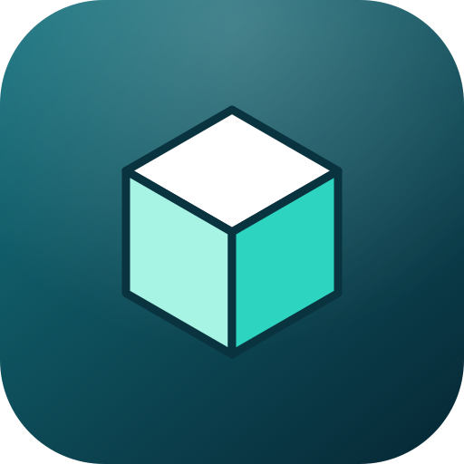
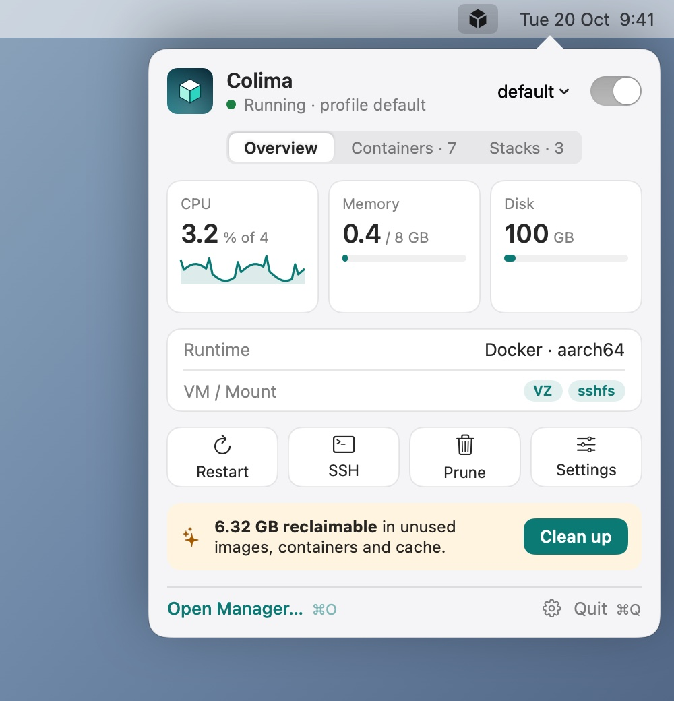

<p align="center">
  
</p>

<h1 align="center">CDesk</h1>

<p align="center">
  A light, native Mac app for <a href="https://github.com/abiosoft/colima">Colima</a> and Docker.<br>
  Menu bar popover, Dock icon, a full manager window, and an MCP server for AI agents.
</p>

<p align="center">
  <a href="https://kalahroudi.github.io/cdesk/">Documentation</a> ·
  <a href="https://github.com/kalahroudi/cdesk/releases">Download</a> ·
  <a href="https://kalahroudi.github.io/cdesk/install.html">Install</a> ·
  <a href="https://kalahroudi.github.io/cdesk/agents.html">Agents (MCP)</a>
</p>

<p align="center">
  
</p>

## Why

Docker Desktop is heavy. Colima is a great, light alternative, but it is command line only, and its best settings are easy to get wrong: some are fixed when the VM is created, DNS breaks when you switch Wi-Fi, and many people stay on slow `sshfs` mounts for years.

CDesk gives Colima a small, friendly UI and applies the optimisation guidance from the community guide [2 Years with Colima](https://iniakunhuda.medium.com/2-years-with-colima-the-optimization-guide-i-wish-i-had-from-day-one-8b89b8155285): `vz` and `virtiofs`, right-sized CPU and memory, fixed DNS, file-change events, and named profiles. Every option has a "?" that says what it is and why.

## What you get

- **Menu bar popover** (with the arrow, like a real macOS popover) and a **Dock icon** that opens the **Manager** window.
- **Colima profiles**: every `colima start` option, grouped. Settings that need a VM rebuild are marked with a lock, and changing them goes through a clear *Recreate VM* sheet with a backup option and type-the-name confirmation.
- **Recommendations for your Mac**: about half your cores and 50% of RAM, with a live view of what the VM takes from macOS.
- **Containers and Compose stacks**: search, paging, select-all and bulk actions, logs, and one-click shells in Terminal or iTerm2.
- **Images and volumes**: pull, remove, spot unused and dangling ones, and reclaim space with prune.
- **Light and dark**, launch at login (on by default, off with one switch), background tasks with notifications, and self-update from releases or the main branch.
- **MCP server** so AI agents can run Colima and Docker for you.

## Light by design

About **40 MB** of memory when idle, a **6.7 MB** app, no third-party dependencies, pure SwiftUI/AppKit. Nothing is polled while the popover and window are closed. Lists are paged, windows free their views on close, and shells open in your own terminal instead of an embedded one.

## Install

Requires macOS 14 or newer (Apple silicon recommended), [Homebrew](https://brew.sh), and Colima with the Docker CLI:

```sh
brew install colima docker
```

Then install CDesk:

```sh
curl -fsSL https://raw.githubusercontent.com/kalahroudi/cdesk/main/scripts/install.sh | bash
```

That downloads the latest release, checks its SHA-256, installs `CDesk.app` into `/Applications` and opens it. Prefer to do it by hand? Download the `.dmg` from [Releases](https://github.com/kalahroudi/cdesk/releases) and drag CDesk to Applications. To build from source:

```sh
git clone https://github.com/kalahroudi/cdesk && cd cdesk
scripts/bundle.sh && cp -R dist/CDesk.app /Applications
```

Full instructions and troubleshooting: [kalahroudi.github.io/cdesk/install.html](https://kalahroudi.github.io/cdesk/install.html).

### Agent prompt

Paste this into an AI coding agent such as Claude Code to install and set up everything:

```text
Install CDesk on this Mac.
1. Check that Homebrew is installed. If colima or docker are missing, run: brew install colima docker
2. Run: curl -fsSL https://raw.githubusercontent.com/kalahroudi/cdesk/main/scripts/install.sh | bash
3. Register its MCP server: claude mcp add cdesk -- /Applications/CDesk.app/Contents/MacOS/cdesk-mcp
4. Call colima_profiles. If there are none, call colima_recommend and start a profile with the recommended
   cpus, memory_gib and disk_gib using colima_start.
5. Tell me what is running.
Never call colima_recreate, docker_remove_volume or docker_prune without asking me first.
```

## Use

Click the cube in the menu bar for the popover: start or stop Colima, see CPU, memory and disk, open a shell in a container, restart a stack. Click the Dock icon (or **Open Manager**, `⌘O`) for everything else. `⌘,` opens Settings.

A short tour with screenshots is in the [usage guide](https://kalahroudi.github.io/cdesk/usage.html).

## MCP server for agents

The app bundle includes `cdesk-mcp`, a stdio [Model Context Protocol](https://modelcontextprotocol.io) server. It uses the same `colima` and `docker` commands as the app and works whether or not the app is open.

```sh
claude mcp add cdesk -- /Applications/CDesk.app/Contents/MacOS/cdesk-mcp
```

or, for any MCP client:

```json
{ "mcpServers": { "cdesk": { "command": "/Applications/CDesk.app/Contents/MacOS/cdesk-mcp" } } }
```

Tools: `colima_profiles`, `colima_config`, `colima_recommend`, `colima_start`, `colima_stop`, `colima_restart`, `colima_recreate`, `docker_containers`, `docker_stats`, `docker_stacks`, `docker_container_action`, `docker_stack_action`, `docker_container_logs`, `docker_exec`, `docker_remove_container`, `docker_images`, `docker_volumes`, `docker_disk_usage`, `docker_pull`, `docker_remove_image`, `docker_remove_volume`, `docker_prune`. Destructive tools (`colima_recreate`, `docker_remove_volume`, `docker_prune`) refuse to run without an explicit confirmation argument. See the [agents guide](https://kalahroudi.github.io/cdesk/agents.html).

## Updates

**Settings → Updates** checks GitHub once a day (you can turn it off). If a newer release exists it downloads the disk image, verifies the SHA-256 and code signature, swaps the app in after it quits, and rolls back automatically if the new version does not start. With no newer release it can build the latest commit of `main` for you (needs the Xcode command line tools).

## Project layout

```
Sources/ColimaKit    UI-free core: colima/docker wrappers, config model, optimiser, update logic
Sources/CDesk        the menu bar + Dock app (SwiftUI/AppKit)
Sources/cdesk-mcp    the MCP server
Tests/               unit tests for ColimaKit
scripts/             bundle, make-dmg, notarize, install
docs/                the GitHub Pages site
```

`ColimaKit` has no UI and no dependencies, so it is easy to reuse in other tools.

## Develop

```sh
swift build        # build everything
swift test         # run the tests
swift run CDesk    # run the app (updates and launch at login only work from the bundled app)
scripts/bundle.sh  # build dist/CDesk.app
scripts/make-dmg.sh 0.1.0
```

`CDesk --snapshot <dir>` renders the screens with sample data to PNG files for the docs. Releases are cut by pushing a tag such as `v0.2.0`: GitHub Actions builds, tests and publishes the disk image and its `SHA256SUMS`. Signing and notarisation turn on automatically when the signing secrets are set. See [CONTRIBUTING.md](CONTRIBUTING.md).

## Credits and license

[Colima](https://github.com/abiosoft/colima) is by Abiosoft and its contributors; CDesk is not affiliated with it. The optimisation approach follows Miftahul Huda's [guide](https://iniakunhuda.medium.com/2-years-with-colima-the-optimization-guide-i-wish-i-had-from-day-one-8b89b8155285).

Licensed under the [Apache License 2.0](LICENSE).
